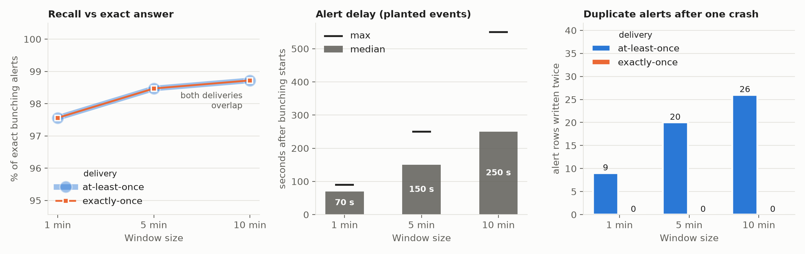

# B25: design comparison (window size x delivery guarantee)

Two design choices of the bus-bunching detector, every combination run on the same workload:

- **Window size**: 1, 5 or 10 minutes of event time per alert (`--window`; the 5-minute movement look-back stays the same).
- **Delivery**: **at-least-once** (alerts appended to Parquet, the detector's default) vs **exactly-once** (idempotent sink: each micro-batch overwrites `alerts/batch_id=<n>`).

```
docker compose up -d kafka
python benchmarks/design_comparison.py          # 3 windows x 2 deliveries, ~20 min
python benchmarks/plot_design_comparison.py     # Markdown table + plot from the newest CSV
```

Tests for the helpers (no Kafka or Spark): `python -m pytest benchmarks`.

## How one run works

1. **Workload, once per sweep.** It is made from a fixed seed, using `fake_feed.py`'s buses and bunching planter on a simulated clock: 40 buses on 4 routes, a report every 10 s for 2 hours, 71 planted bunching events, and 10% of reports delivered 1–10 minutes late. That gives 28,662 reports, 2,788 of them late. The last record is a "flush" report 2 h ahead, so every window closes.
2. The workload is produced to a fresh Kafka topic (3 partitions, idempotent producer, so the producer adds no duplicates). The real detector, `streaming/detect_bunching.py`, reads it at 160 records per micro-batch (`--max-offsets`, about 40 s of feed), with a 1 s trigger and a 30 s watermark.
3. **One crash per run.** Half way through, right after a micro-batch has written its alerts and *before* Spark commits that batch, the job SIGKILLs itself (driver + JVM; `--crash-at-batch`). The harness restarts it on the same checkpoint, so Spark runs that batch again. This is the at-least-once gap of `foreachBatch`, which Spark's exactly-once file sink does not cover.
4. **Scoring** uses two answers:
   - **Exact**: the detector's own rule (`bunching_pairs`) applied to *all* reports in the same Spark windows, with no watermark. This is what the detector would report if no report were late (the B18 idea).
   - **Planted**: the 71 planted events, matched as in `evaluate_bunching.py`.

   Alert delay is the time from when a planted bunching starts until its first alert can be emitted (window end + watermark, in event time).

Results: `results/b25_runs_20261114_2305.csv` (one row per run), `results/b25_workload_20261114_2305.json`, plot `results/b25_design_comparison_20261114_2305.png`. Run on one MacBook (M1 Pro): Spark `local[*]`, single-broker Kafka in Docker.

## Results

| Window | Delivery | Recall vs exact | Precision vs exact | Planted caught | Median / max alert delay (s) | Late window-rows dropped | Duplicate alerts after 1 crash | State rows (max) | Batch ms (mean) |
| --- | --- | --- | --- | --- | --- | --- | --- | --- | --- |
| 1 min | at-least-once | 97.6% (801/821) | 100.0% | 71/71 | 70 / 90 | 6.9% | **9** of 810 rows | 90 | 559 |
| 1 min | exactly-once | 97.6% (801/821) | 100.0% | 71/71 | 70 / 90 | 6.9% | **0** of 801 rows | 90 | 549 |
| 5 min | at-least-once | 98.5% (321/326) | 100.0% | 71/71 | 150 / 250 | 3.3% | **20** of 341 rows | 24 | 448 |
| 5 min | exactly-once | 98.5% (321/326) | 100.0% | 71/71 | 150 / 250 | 3.3% | **0** of 321 rows | 24 | 455 |
| 10 min | at-least-once | 98.7% (231/234) | 100.0% | 71/71 | 250 / 550 | 2.1% | **26** of 257 rows | 16 | 469 |
| 10 min | exactly-once | 98.7% (231/234) | 100.0% | 71/71 | 250 / 550 | 2.1% | **0** of 231 rows | 16 | 543 |



"Late window-rows dropped" is Spark's `numRowsDroppedByWatermark` as a share of all (report, window) rows. A late report is dropped only from the windows that had already closed when it arrived.

## Analysis

**Window size trades alert delay for a little recall.**
- Longer windows keep more late reports: 6.9% of window rows are dropped at 1 minute, 3.3% at 5 minutes and 2.1% at 10 minutes. A report that is 1–10 minutes late often still finds its 10-minute window open, but almost never its 1-minute window.
- So recall against the exact answer rises from 97.6% to 98.5% to 98.7%.
- The gain is small, and every window size caught all 71 planted events. The alerts that were missed are marginal pairs, where a dropped report changed the closest distance or the movement check.
- Precision is 100% everywhere: dropping late reports only ever removes alerts, it never creates false ones.
- The cost is latency. An alert can only be emitted once its window closes, so the delay is about window + watermark: a median of 70 s for 1-minute windows, 150 s for 5 and 250 s for 10, with a worst case of 90 s, 250 s and 550 s.
- Larger windows hold less state (90 → 24 → 16 rows), because the sliding window overlaps itself fewer times. Batch time stays at 0.45–0.56 s either way, well inside the 1 s trigger.
- **Recommendation: keep 1-minute windows for live alerts.** A rider-facing bunching alert that comes 4–9 minutes late is worth less than the 1.1 points of recall it buys. If late feeds become a problem, a longer watermark is the other lever; it was not measured here.

**The delivery guarantee changes duplicates and nothing else.**
- One crash between the sink write and the batch commit left 9, 20 and 26 duplicate alert rows with the append sink: every alert of the replayed batch, written twice. Bigger windows emit more alerts per closing batch, so one replay duplicates more of them.
- The idempotent sink had **0 duplicates** in every run.
- Recall, alert delay and late drops are identical between the two modes, because the replayed batch has the same offsets and the same window state.
- Restart time is the same, about 7 s from crash to the first committed batch. That matches B24's Spark kill (about 4 s for the JVM and query, then the first batch).
- Batch time is within noise for 1 and 5 minutes. At 10 minutes the idempotent run was 74 ms slower on average; with one run per setting, that is not established as a real cost.
- **Recommendation: use the idempotent sink for every `foreachBatch` detector.** It costs nothing measurable here, and a downstream count of alerts (dashboards, B27 fairness) would otherwise be inflated after every crash.

**How this fits with B22 and B24.**
- Exactly-once from end to end needs both ends:
  - **Producer side**: B24 found that an at-least-once producer can store a batch twice when Kafka dies, and that the idempotent producer prevents it.
  - **Sink side**: the archive job's Parquet file sink is already exactly-once (no duplicates in B24's five Spark kills). The detectors' `foreachBatch` writes are not, as this run shows.
  - The MongoDB alert sink (B11) gets the same protection from deterministic `_id`s.
- Latency: B22 measured about 0.8 s from producer to Parquet at a 1 s trigger. For alerts that is negligible next to the window, so the window size, not the pipeline, sets how fast an alert arrives.

## Limits

- **Synthetic workload.** The 10% late share with 1–10 minute delays is an assumption, not measured from the 511 feeds. Most "exact" alerts are random bunching of the fake buses, not the planted events. The next step is to score a recorded live replay with the B18 ground-truth scan.
- **One run and one crash per setting.** The workload is deterministic, so recall and delay repeat exactly. Batch times and restart times do not; use more runs before quoting small differences between them.
- **Idempotent layout.** One folder per micro-batch means many small files; a long-running deployment would compact them. Readers must read the whole `alerts/` folder (pandas and Spark both pick up the `batch_id=` folders).
