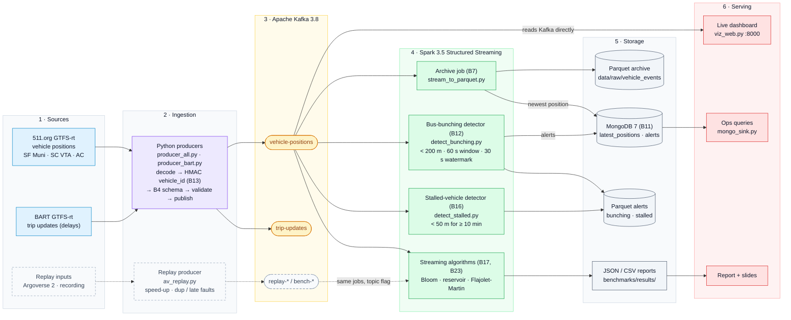
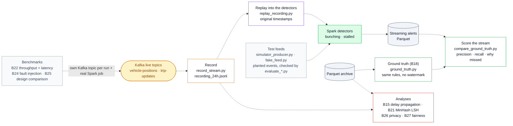

# Pipeline flow diagram (B29)

Mermaid source for the data flow, for GitHub and Notion. The static figure for the report and slides is
[`flow_diagram.svg`](flow_diagram.svg) / [`flow_diagram.png`](flow_diagram.png).

## 1. Live pipeline

Solid arrows = live path. Dashed = replay path (same jobs, different topic).

## 2. Offline: testing and evaluation

## Notes

- **Vehicle IDs are hashed at ingestion** (HMAC-SHA256, B13), so raw IDs never reach Kafka, Parquet or MongoDB.
- **The dashboard reads Kafka directly**, not MongoDB. It hides simulated (SIM) and replayed events.
- **trip-updates has no streaming job yet.** BART delays are recorded and analysed offline (B15).
- **No warehouse.** ClickHouse / DuckDB is in the README plan but not in the code.
- **MongoDB writes are idempotent:** alerts use a deterministic `_id`, and a position only replaces an older one.
